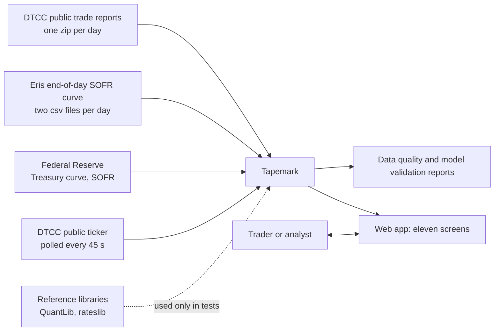
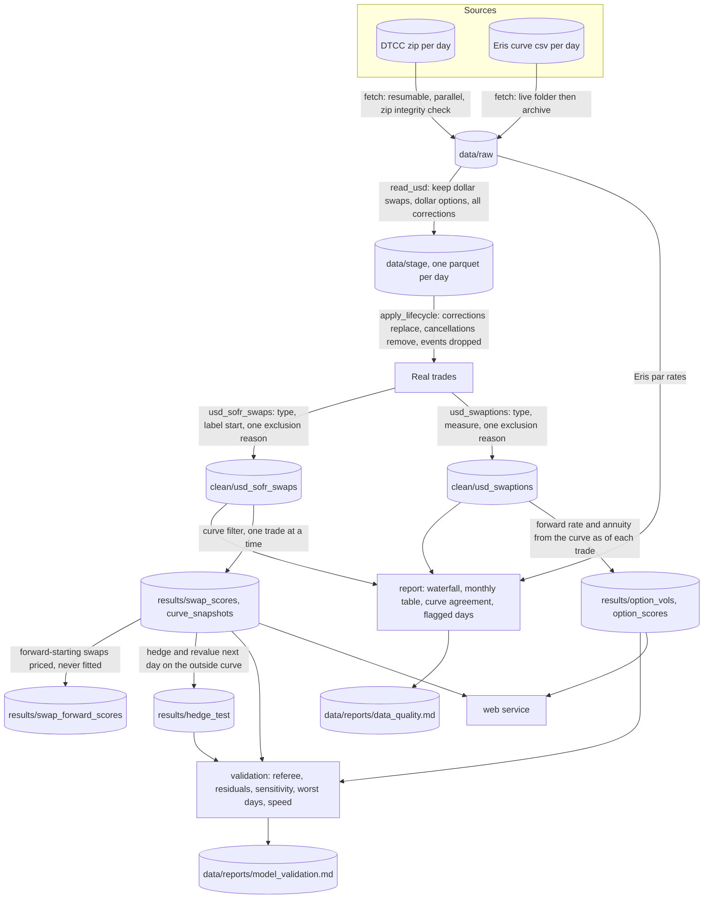
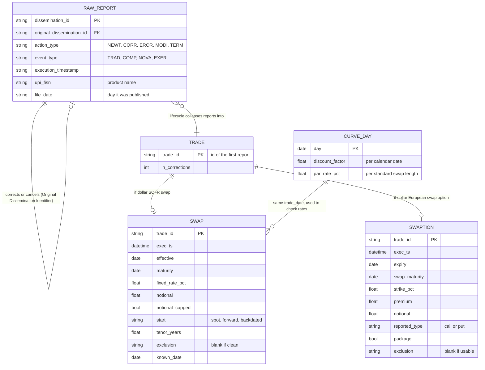
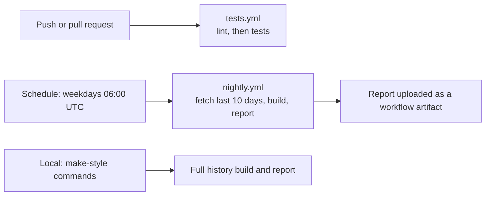
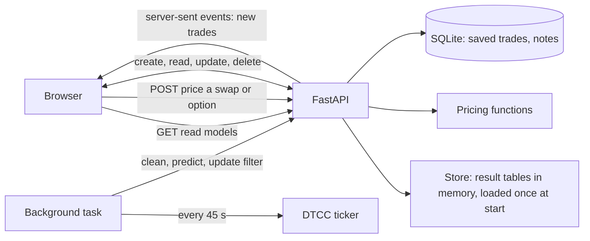

# Architecture

High-level design: what the system is, what it talks to, how data moves, and
how it runs. Module-level detail is in [DESIGN.md](DESIGN.md). Reasons for the
choices are in [adr/](adr/README.md).

## 1. Context

Tapemark is a daily batch pipeline plus a small web service. The pipeline
reads public files and writes local tables, model results and reports. The
service reads those results, prices trades on request, stores saved trades and
notes, and follows a public live ticker.

## 2. Layers

Data moves one way through four layers. Each layer can be deleted and rebuilt
from the one before it; only `raw` cannot be recreated once a source closes.

| Layer | Location | Contents | Rebuildable |
|---|---|---|---|
| Raw | `data/raw/` | Files exactly as downloaded | No: this is the archive |
| Stage | `data/stage/` | One table per day: dollar swaps and options, needed columns only, plus all corrections | Yes |
| Clean | `data/clean/` | One row per real trade, typed and labelled, with an exclusion reason | Yes |
| Results | `data/results/` | Per-trade predictions, curve snapshots, option volatilities, summaries | Yes |
| Reports | `data/reports/` | Data quality report and model validation report | Yes |
| Saved items | `data/app.db` | Saved trades and notes on days, written by the app | No: user data |

## 3. Data flow

## 4. Data model

## 5. Components

| Component | Module | Responsibility |
|---|---|---|
| Source adapters | `tapemark.sources.dtcc`, `tapemark.sources.eris` | Know one provider's URLs and file format. Nothing else does. |
| Lifecycle | `tapemark.clean.lifecycle` | Turn a log of reports into one row per real trade |
| Product cleaners | `tapemark.clean.swaps`, `tapemark.clean.swaptions` | Type fields, derive measures, assign one exclusion reason |
| Report | `tapemark.report` | Summarise coverage, exclusions, outside agreement, unusual days |
| Command line | `tapemark.cli` | `fetch`, `build`, `summary`, `audit`, `report` |
| Pricing | `tapemark.pricing.{calendar,curve,options,risk}` | Pure functions: business days, curve build, swap and option prices, risk by curve point. No files, no network |
| Curve model | `tapemark.models.curve_filter` | Kalman filter over par rates; predicts each trade, then learns from it |
| Scoring | `tapemark.scoring.{swaps,options,risk}` | Walk-forward predictions, baselines, significance, calibration, hedge test |
| Validation | `tapemark.validation` | Gathers every check into one report with verdicts |
| Other markets | `tapemark.markets`, `tapemark.sources.fed` | Other currencies, inflation swaps, Treasury curve, SOFR |
| Research | `tapemark.insights` | Correlations, implied against realised volatility, rich/cheap screen, gap drivers |
| Web service | `tapemark.server.{store,app}` | Read models, pricing endpoints, saved items, live feed |
| Frontend | `web/` | Plain HTML, CSS and ES modules; hand-written SVG charts |

## 6. How it runs

- **On every push:** lint and the test suite. Tests use hand-built rows, so they need no network.
- **Nightly:** a short window of real files is fetched and the whole pipeline runs end to end. This catches a changed file format or a moved URL within a day. The report is kept as a workflow artifact; data is not committed.
- **Full history:** built locally, about 1.3 GB of raw files.

## 7. The web service at run time

- **Read models** are computed from tables loaded once at start (about 4 seconds). No request reads from disk except saved items.
- **Pricing** is stateless: terms in, numbers out, on the curve of the chosen day.
- **Saved items** are the only writes. A saved trade stores terms only and is repriced on every read, so it cannot go stale.
- **Live rows** are held in memory and never written to the data folders.

## 8. Qualities the design protects

| Quality | How |
|---|---|
| Reproducible | Raw files immutable; every later table is a pure function of them |
| Auditable | Each excluded trade carries one reason; counts add up in the report |
| Honest about time | Each row keeps the date it became public (`known_date`) |
| Resilient | Downloads resume; one unreadable file is recorded and skipped, not fatal |
| Tolerant of schema change | Missing columns are filled blank and counted in the report |
| Portable | No database server; runs from a fresh clone |
