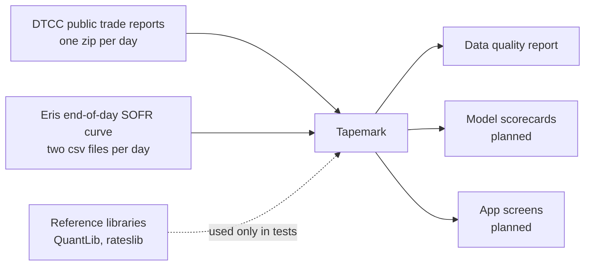
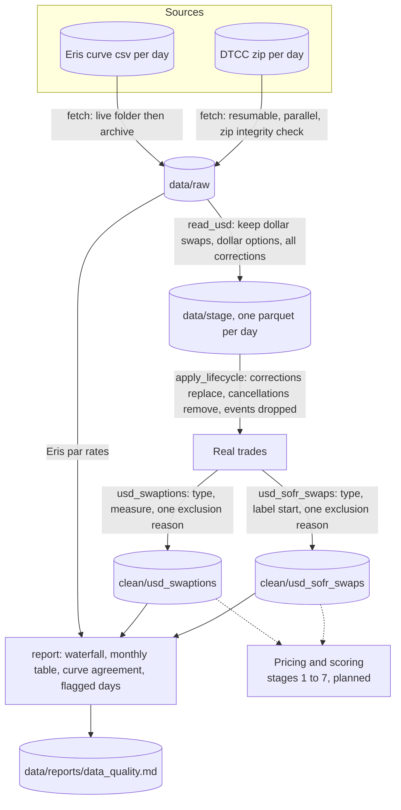
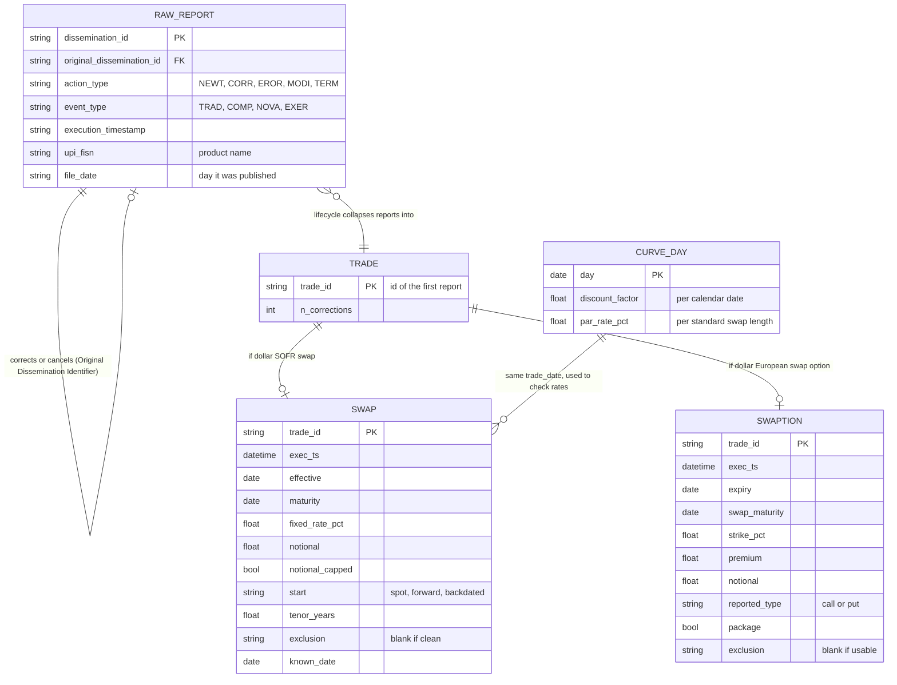
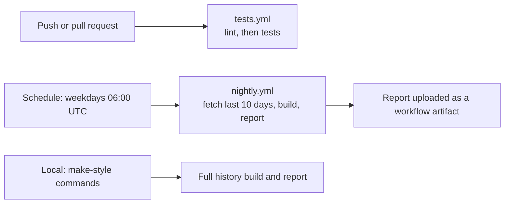

# Architecture

High-level design: what the system is, what it talks to, how data moves, and
how it runs. Module-level detail is in [DESIGN.md](DESIGN.md). Reasons for the
choices are in [adr/](adr/README.md).

## 1. Context

Tapemark is a daily batch system. It reads public files, writes local tables
and reports, and has no users writing into it.

## 2. Layers

Data moves one way through four layers. Each layer can be deleted and rebuilt
from the one before it; only `raw` cannot be recreated once a source closes.

| Layer | Location | Contents | Rebuildable |
|---|---|---|---|
| Raw | `data/raw/` | Files exactly as downloaded | No: this is the archive |
| Stage | `data/stage/` | One table per day: dollar swaps and options, needed columns only, plus all corrections | Yes |
| Clean | `data/clean/` | One row per real trade, typed and labelled, with an exclusion reason | Yes |
| Reports | `data/reports/` | Data quality report; later, model scorecards | Yes |

## 3. Data flow

## 4. Data model

## 5. Components

| Component | Module | Responsibility |
|---|---|---|
| Source adapters | `tapemark.sources.dtcc`, `tapemark.sources.eris` | Know one provider's URLs and file format. Nothing else does. |
| Lifecycle | `tapemark.clean.lifecycle` | Turn a log of reports into one row per real trade |
| Product cleaners | `tapemark.clean.swaps`, `tapemark.clean.swaptions` | Type fields, derive measures, assign one exclusion reason |
| Report | `tapemark.report` | Summarise coverage, exclusions, outside agreement, unusual days |
| Command line | `tapemark.cli` | `fetch`, `build`, `summary`, `audit`, `report` |
| Pricing, curves, scoring | planned | Stages 1 to 7; pure functions with no file or network access |

## 6. How it runs

- **On every push:** lint and the test suite. Tests use hand-built rows, so they need no network.
- **Nightly:** a short window of real files is fetched and the whole pipeline runs end to end. This catches a changed file format or a moved URL within a day. The report is kept as a workflow artifact; data is not committed.
- **Full history:** built locally, about 1.3 GB of raw files.

## 7. Qualities the design protects

| Quality | How |
|---|---|
| Reproducible | Raw files immutable; every later table is a pure function of them |
| Auditable | Each excluded trade carries one reason; counts add up in the report |
| Honest about time | Each row keeps the date it became public (`known_date`) |
| Resilient | Downloads resume; one unreadable file is recorded and skipped, not fatal |
| Tolerant of schema change | Missing columns are filled blank and counted in the report |
| Portable | No database server; runs from a fresh clone |
